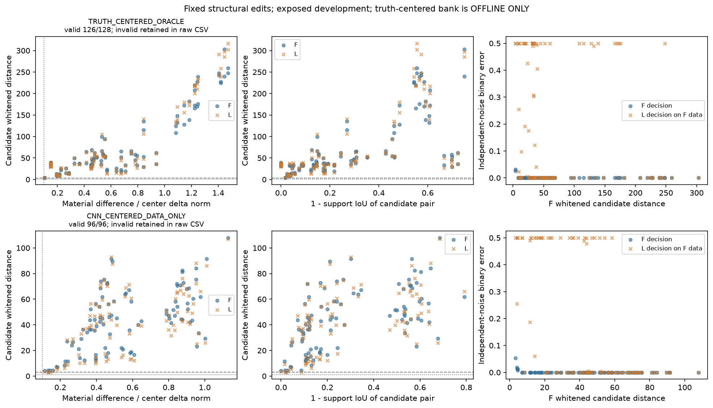
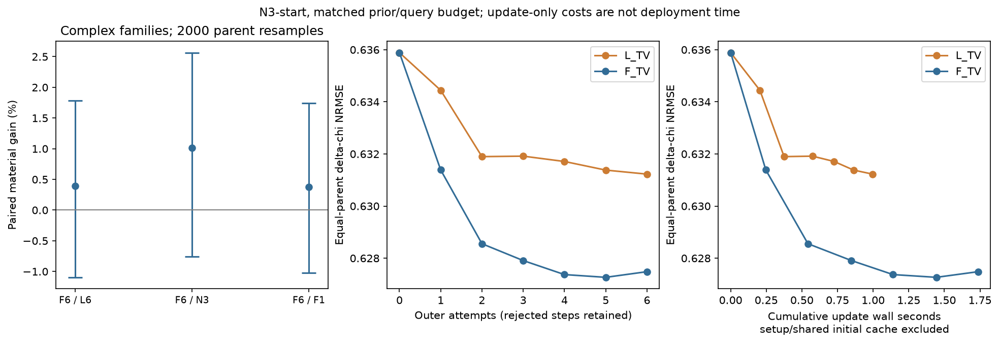
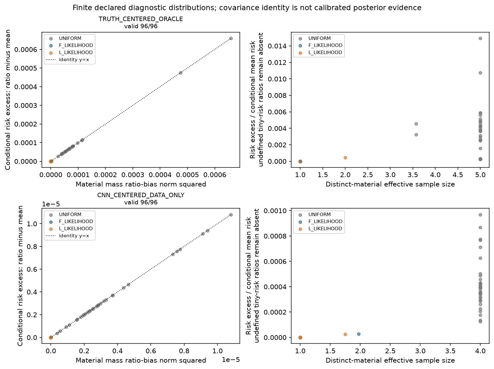
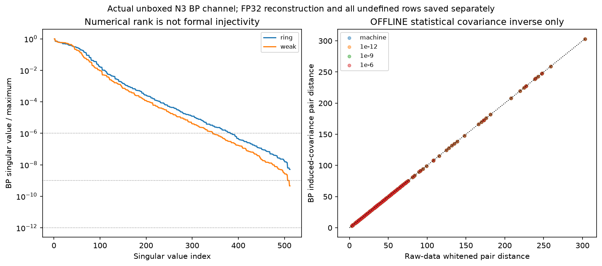

# A28-E1：材料信息存在，但现有候选与更新没有恢复复杂结构

## 结论与执行状态

完整非线性 Maxwell 数据可以区分这组固定结构反事实。它不意味着现有 CNN、有限候选后验或六步 TV 更新已经能利用这些信息恢复复杂材料。复杂三家族的 F 六步相对 N3 材料改善仅 **1.01%**，相对 L 六步仅 **0.40%**；两者 parent bootstrap 区间均跨零。相对 N3 的完整数据残差下降 **27.33%**，材料与数据收益明显不等价。

**不启动 E2，不启动 E3，不启动 κ 网络。停止当前“精确 feedback 后处理即可恢复复杂结构”的扩展。** F 的正确似然仍有有限候选判别价值，不能把这个结论改写为“Maxwell 没有材料信息”或永久否定所有 feedback 研究。

另有严重执行缺陷：主实验计数为 **762**，但三次继承测试各执行15次真实8×8 TM 后端 forward，绕过状态预约。严格全分辨率已知下界为 **至少807 / 768**，超限至少39次；独立 tiny dense-reference 的额外状态归类尚不完备。**预算合规 FAIL**。发现后停止全部物理解算，仅继续读取已有证据、修复计数器和公开交付。原 receipts、冻结配置和阈值没有被改写；科学观察可保留，本次执行不能作为合规 GO。

## 1. 背景：为什么要把材料信息与成像算法分开

逆散射的接收器只测到有限电磁场；材料的边界、空腔和细部件通过内部场间接改变测量。准确预测场，并不保证可以稳定反推出这些结构。CNN 可从训练分布补全结构，但也可能把有数据证据的空腔填成实心。完整 feedback 可修正电磁预测，却可能主要改变可观测的平滑材料组合，留下边缘误差。

这里分开检验四件事：固定材料对是否可分、合法更新能否改善图像、条件均值的本构偏差是否有材料风险意义、实际 BP 编码是否丢掉候选信息。理论及反例保留在[原研究包](theory/a28/A28_RESEARCH_REPORT_ZH.md)，不是本报告重新建立的理论。冻结来源为 [A27](https://github.com/migodam/a27-feedback-failure-attribution/tree/325cc8a5f99d686ce1b1570296f94b0df1e90141)、[A26](https://github.com/migodam/a26-om-feedback-prior-completion/tree/2603f3bd16c48e48587fedc4363975779def17f5)、[A25](https://github.com/migodam/a25-adaptive-om-feedback/tree/59d8cc57c9da99ccb7978febc308193c43d6f3e5)。旧结果不覆盖。

## 2. 冻结物理、数据与信息边界

实际实验为已知背景的 **2D scalar TM、24×24、8源、32接收器**；不能宣称3D Vector-Maxwell性能。材料是完整网格576个复数，实质量坐标1152维；接收数据按每源 `[Re32, Im32]` 排列，共512维实数据。单元面积为1/576，场/电流采用其平方根质量归一化。

复用 A24/A25 的 Green、自单元、本构、背景及 A27 exact LU。对于每个源，`c=χe`、`e=e_inc+Gc`、`y=Sc`；F 使用完整状态，L 使用同一已知背景的 dressed-linear 响应。没有新 solver、ridge、伪逆、rank 搜索或 full fallback。材料 box 为 `Reχ∈[-0.5,4]`、`Imχ∈[0,0.5]`。

16个已暴露 development parents：shell 250065–250068，asymmetric 250069–250072，smooth 250073–250076，mixed-scale 250077–250080。每 parent 使用 weak/ring 两背景、幅度1.2、20dB，合计32条件。原标签增量具有固定复相位 `1+0.2i`；结果不推广为任意独立实虚部材料。32个原 clean current/field 复用，新增训练标签为零；N3 checkpoint 原样复现128个预测，相对差为0。locked ID/OOD 未打开，没有科研网络训练。

先完成 audit/microbenchmark，再冻结全部 cohort、TRAIN 编辑规则、随机种子及预算。规则不接收 development family、真值边界或误差方向。真值中心 bank 是 **OFFLINE IDENTIFIABILITY ONLY**；CNN中心 bank 从测量产生的N3图像生成，是合法候选来源，但其先验依赖测量，不是校准后验。所有真值评分在候选/更新返回以后执行。

## 3. 验证层级

随包14项代数检查通过；它们证明有限矩阵实例的恒等式，没有证明成像优越性。继承与新增测试最终231项通过、无skip；XINAN早期218项中3项独立Clarabel测试因依赖缺失skip，不能写成远端独立SOCP验证通过。最终计数修复另以65项 arithmetic/fake-ledger 测试验收，全部通过、无真实后端执行，见[修复验收](results/a28/jobs/a28-budget-repair-fake-tests-003/RESULT.json)。修复过程的源码导入与计数schema失败同样保留在失败账本。

真实24×24后端：Torch与原SciPy数据相对差最大 `5.40e−16`，实质量伴随缺陷最大 `5.10e−17`，四档差分在稳定平台误差远小于 `1e−5`。原 clean 本构/接收恒等式通过。完整与有限幅度割线、条件矩和传播恒等式均由实际八源 fields 核对。候选/轨迹数值失败为零；两个无法改变材料的 cavity 编辑保留为 INVALID_ZERO_EDIT。

## 4. A：固定结构反事实可以被测量区分

TRAIN冻结的三种编辑为 cavity 填充/打开、单cell边界扩张、细部件增删，含受限积分对比补偿；truth bank另有contrast-only控制，不用于结构门槛。原 noisy measurement用于候选来源；每对固定候选另用独立seed、每假设1000次新噪声判断错误率。噪声重复不增加独立parent数。

对白化距离使用

`d_F = sqrt(2) ||F(χ1)−F(χ0)|| / σ`。

这是proper complex Gaussian、实虚方差各σ²/2的固定二元问题；等先验最优错误率为 `Φ(−d_F/2)`。L的`Φ(−d_L/2)`只描述L生成数据的世界，不能代替L在真实F数据上的错误率。σ对每个原条件固定；原A25噪声生成是随signal变化的，因此这些权重不是整个异方差生成器的精确后验。

| 复杂三家族结构bank | 计划对数 | 有效且材料ΔNRMSE≥0.10 | F下d≥3 | F下d≤1 | F清晰而L未达3 |
|---|---:|---:|---:|---:|---:|
| 真值中心，OFFLINE | 72 | 70 | 70 | 0 | 0 |
| CNN中心 | 72 | 72 | 72 | 0 | 1 |

真值中心全部家族是94/96计划结构对清晰，2个编辑无效。复杂真值中心有效对F距离范围3.661–303.208，L范围3.679–316.934；描述性平均独立噪声错误率为F **0.084%**、L-on-F **15.24%**。这两个错误率是有效固定对的描述性结果，不是删除失败后的总体成功率或独立场景置信区间。

N3与原真值的32个端点对也全部满足F d≥3，范围8.778–64.167，中位25.198。说明当前预测与真值之间存在测量差异。**无法把这些对数换算为“剩余材料误差中多少百分比可唯一恢复”**：它们只证明指定端点/结构对可分，不代表完整材料类的唯一性或最优风险。

### F的优势包含模型偏差修正，不能全部叫新增结构信息

许多固定结构对L自身也具有大距离；没有发现大量“L下模糊、F下清晰”的结构见证。F似然更正确，但L-on-F错误同时混合了绝对response偏差、割线方向及幅度差。

为解释这一点，结果之后仅用缓存添加了 **POSTHOC / OFFLINE / NOT_GATE_INPUT** 对照：把L中心或中点用已知F响应校准，不重新求解物理。222有效对的解析L-on-F平均错误为17.47%；F中心校准后为0.654%，F中点校准后为0.142%。割线cosine中位0.897。这不提供可部署算法——校准读取了候选F响应——但说明原错判的大部分不能直接归因为L丢失了不可替代的材料维度。原门槛不使用该事后诊断。

原始证据：[pair metrics](results/a28/anatomy/PAIR_METRICS.csv)、[端点与背景谱](results/a28/anatomy/BASELINE_DIAGNOSTICS.csv)、[事后偏差分解](results/a28/POSTHOC_PAIR_BIAS_DIAGNOSTIC.csv)。

## 5. B：六步没有恢复复杂结构余量

起点为同一N3。两臂使用相同全网格材料、joint real/imag TV、box、谱步长规则、trust半径0.15、六次outer attempts，每次至多一个付费候选；拒绝后下一次damping减半。TV系数为 `.001(1+σ/background_RMS)`；prox沿用认证FGP，KKT/gap1e−6、可行性1e−10，不放宽门槛。接受仅看完整F目标/残差与Armijo，不看真值。

普通 full-state adjoint+相同TV与F_TV是代数相同的基线，不伪造第三条“被F击败”的轨迹。L候选也支付完整F接受审核，因而这是匹配更新/候选审核预算，不是纯廉价L部署。F/L实际RHS和wall-time分别记账。六步gradient/prox路径不是GN、全局最优重建或所有算法headroom的上界。

| 家族，parent等权 | N3 ΔNRMSE | L六步 | F六步 | F/N3配对改善 | F/L配对改善 |
|---|---:|---:|---:|---:|---:|
| shell | 0.61863 | 0.61754 | 0.61920 | −0.41% | −0.56% |
| asymmetric | 0.71954 | 0.70814 | 0.69758 | +2.98% | +1.53% |
| mixed-scale | 0.56950 | 0.56800 | 0.56567 | +0.47% | +0.22% |
| **复杂三家族** | **0.63589** | **0.63123** | **0.62748** | **+1.01%** | **+0.40%** |
| smooth，次要 | 0.39048 | 0.37647 | 0.32600 | +16.23% | +13.02% |

先平均parent内两背景，再计算各parent相对改善，最后等权与2000次paired bootstrap；所以配对改善不等于表内均值的比值。复杂F6/N3的95%区间为 **[−0.76%, 2.57%]**，F6/L6为 **[−1.10%, 1.78%]**，F6/F1为 **[−1.02%, 1.74%]**。没有达到冻结的10%材料余量。

复杂F6/N3的数据残差改善 **27.33% [22.46%,32.07%]**，IoU绝对增加0.01453，edge F1增加0.00397且区间跨零。全部448个逐迭代记录完整，32条件×两臂无数值缺失；拒绝没有删除。材料图仍可见shell空腔被填、细部件模糊；F在smooth上的16.23%收益是真实次要信号，不拿它替代复杂结构的主门槛。

### 候选覆盖本身是反例

CNN有限bank的F材料均值相对L均值在复杂组改善 **10.23% [5.33%,15.17%]**，但相对原N3反而恶化 **2.38% [0.50%,4.77%]**。不能把“胜过较差的L teacher”冒充重建headroom。

事后离线用真值选同一合法bank内最优候选，仅作为覆盖上界：复杂parent平均最大可改善 **0.110%**，最大parent **0.914%**。这个bank几乎没有更好的完整材料候选。它的失败不能证明所有结构先验/多步方法无效，却足以阻止把它直接用于E2蒸馏。

原始证据：[每步表](results/a28/headroom/PER_ITERATION.csv)、[parent配对统计](results/a28/artifacts/HEADROOM_PAIRED_STATISTICS.csv)、[有限bank配对](results/a28/artifacts/POSTERIOR_DECISION_PAIRED.csv)、[OFFLINE覆盖上界](results/a28/OFFLINE_LEGAL_BANK_COVERAGE.csv)。

## 6. C：κ恒等式正确，材料有效性不支持新representation

有限bank明确使用uniform labelled prior，再分别以F/L likelihood重加权；另保留uniform控制。L权重也平均实际F产生的候选current/field。无效编辑的重复中心保留原先验质量，并另外合并相同材料报告distinct-material ESS；不能把重复标签称为真实材料歧义。

材料与场的双线性协方差不带共轭：

`κ_s = E[(χ−μχ)(e_s−μe_s)]`，`μc_s=μχ μe_s+κ_s`。

将平均电流除以平均场的多源least-squares ratio，偏差严格为

`Q(μc)−μχ = Σ_s conj(μe_s) κ_s / Σ_s |μe_s|²`。

完整F在材料均值处与平均F数据之差严格为 `−S L(μχ)⁻¹κ`。材料均值是该有限分布下平方材料损失的Bayes action；任何点修正的条件风险增加等于其偏离均值的质量范数平方。这些精确式不能反过来证明CNN是实际后验均值。

192个条件分布的本构/closed-mean缺陷最大约2e−15，ratio material-scaled缺陷9.15e−16，32次完整传播commutator缺陷8.31e−16，risk identity绝对缺陷9.11e−18。数值恒等式成立。

CNN-F likelihood的distinct ESS中位 **1.0**，32条件只有 **1** 个达到1.5；ratio偏差相对真值材料增量尺度最大 **0.02338%**，均值0.000731%。同时非退化且偏差≥1%的条件为 **0/32**，冻结要求为至少8。人为uniform bank的偏差最大1.81%，不是noise-conditioned learning representation证据。

32个有限均值的一次F/TV修正全部被数据规则接受，条件bank风险均上升；均值增加约1.31e−4。这部分上升由平方损失恒等式保证，不是独立的“物理更新有害”证明。窄bank本身失配：smooth的F均值材料误差0.6790，明显差于N3的0.3905，却给出接近零条件方差。如此自信不代表实际后验校准。

因此κ不能解释当前约0.65的复杂材料误差，也不足以启动κ预测网络。这只否决当前有限候选下的证据，不否定更丰富真实后验中协方差可能重要。

原始证据：[全部条件矩](results/a28/posterior/PER_DISTRIBUTION.csv)、[material decisions](results/a28/posterior/DECISIONS.csv)，current/field/κ原数组在Release。

## 7. D：实际BP没有显示候选判别信息大量丢失

审计A26 N3实际未box的BP特征，矩阵大小1152×512。FP64机器阈值下两背景均为 **rank512**；不是预设的rank截断。全谱条件数很大：weak **2.18e9**，ring **1.97e8**。因此不能把有限精度rank当作稳定可逆性证明。

用BP诱导噪声协方差而非Euclidean norm比较候选距离。该协方差SVD逆仅作 **OFFLINE统计诊断**，没有用于Maxwell solver。固定1e−6 cutoff下，保留rank为weak344、ring382；候选白化判别能量最低仍为 **99.8698% / 99.99992%**。

实际FP32特征反解完整测量会放大极弱尾部，machine cutoff中位相对反解误差约11.85/1.39；不能称encoder无损。丢弃同一固定弱尾部后，实际FP32 BP的测量差重构误差中位约 **1.73% / 1.12%**，候选强判别成分主要保留。没有证据支持默认增加raw-data bypass。其余12通道含非线性操作，整体噪声信息未由BP-only SVD认证。

固定clean反事实输入下的原CNN nearest-material-pair诊断，在每个复杂parent都找到至少一个F清晰而CNN材料proxy选错的结构对。它不是Bayes分类性能，也不是1000次CNN噪声验证，但结合保留的BP距离和实际材料图，支持“decoder/prior/候选及更新未利用信息”，而非“BP必然抹掉信息”。

原始证据：[BP全部cutoffs](results/a28/bp/PAIR_INFORMATION.csv)、[clean CNN反事实响应](results/a28/bp/CNN_COUNTERFACTUAL_RESPONSE.csv)。

## 8. 成本、失败与协议缺陷

目标硬件XINAN RTX4060 Laptop/8GB，物理complex128/float64，CNN沿用已训练float32。microbenchmark实际完整单状态约22–32ms，不是端到端成像latency。

六步复杂组增量wall均值：L约 **0.997s**，F约 **1.738s**；不包含N3起点推理、背景setup和共享初始F状态。它们不能冒充40ms部署。完整headroom job GPU占用105.820s，host CPU79.219s；TV prox独占约53.88s，F-LU约11.88s。F和L各192个候选完整审核，合计384次full LU、3072个forward RHS；F另有1536个adjoint、1536个JVP RHS。全部action与嵌套/独占时间留在原ledger，不重复求和。

审计、micro、anatomy、headroom、posterior、BP等的GPU占用按完整作业wall计费，合计 **327.56s**；所有host CPU、测试、传输、汇总、失败和发布另列于[COST_LEDGER](results/a28/COST_LEDGER.jsonl)和[成本汇总](results/a28/COST_SUMMARY.json)。CPU/GPU时间均低于冻结的各3600s上限，状态次数门槛仍为FAIL。最终发布/核验sidecar有明确cutoff，不伪装为预发布总计。

**状态预算违规不能藏在tiny tests里。** 762次24×24计数＋至少45次真实8×8测试为已知下界807；原计划764不含这45次，是执行错误。修复后的history恢复该下界，物理reserve与GPU/科学stage拒绝继续运行，只允许明确CPU evidence/delivery保存结果。默认unit入口改成A28 arithmetic/guard tests；重跑任何真实backend fixture必须预约。

另保留：一次inventory schema-role失败、一次Windows换行造成的冻结JSON上传拒绝、一次有锁时被拒绝的headroom启动（无物理工作、保守计1 CPU秒）、2个无效cavity编辑。没有静默fallback、筛除失败parent或降低KKT容差。详情见[FAILURE_LEDGER](results/a28/FAILURE_LEDGER.jsonl)。

## 9. 冻结gate与下一步

| 条件 | 已有观察 | 裁决 |
|---|---|---|
| 重要结构可分且CNN漏掉，至少4复杂parents | 固定对满足；12复杂parents有clean decoder proxy遗漏 | 有限样本支持，不是全局唯一性 |
| 合法复杂材料headroom≥10%且parent CI支持 | F6/N3仅1.01%，区间跨零；有限均值更差 | **NO_GO E2** |
| 至少4复杂parents、两家族的重要F歧义d≤1 | 指定有效结构bank中为0 | **NO_GO E3 from this evidence**；不能证明无其它歧义 |
| κ非退化且材料有效，至少8条件 | 0/32 | **NO_GO κ network** |
| 全分辨率状态评估≤768 | 已知下界≥807 | **FAIL protocol compliance** |

F六步对复杂图像相对L仅0.40%，边缘没有可靠增加，因此停止当前feedback-specific在线后处理与压缩扩展。有限bank中F相对L的10.23%决策改善说明正确物理likelihood仍有价值；它不是“F一切无用”的证据，且不能盖过候选几乎无重建覆盖、相对N3无余量和预算违规。

如另行授权新的development，先建立真值不参与生成、实际能覆盖空腔/细部件错误的结构候选或更合适先验；先修复并统一所有后端测试的预约，再做独立新协议。保留相同BP和强普通先验控制，不默认新OM架构、raw bypass或κ head。这里不执行该扩展，不设计/训练新的网络。

## 10. 对五个问题的直接回答

1. **多少剩余错误含F可判别信息？** 32个N3–truth端点对与70个有效复杂truth结构对均清晰；不能据此给出剩余材料误差的全局百分比。局部背景强谱只含复杂误差能量约2.33%，也不是后验可识别比例。
2. **F相对L的结构判别增量？** 正确F likelihood减少固定对错判，但几乎没有新的L模糊/F清晰对；偏差校准解释大部分错判。有限bank的材料决策有10.23%相对L优势，仍差于N3。
3. **CNN和多步利用了信息吗？** 有结构proxy遗漏；六步复杂材料改善1.01%不足，数据改善27.33%。smooth收益保留，不能推广到复杂结构。
4. **κ值得作为新的learning representation吗？** 当前NO_GO：恒等式通过，非退化与材料有效性条件未通过。
5. **GO E2、GO E3或停止？** 当前不GO两者，停止当前在线feedback-specific扩展；不宣称永久停止Maxwell信息/先验研究。严格执行合规另为FAIL。

## 11. 复现与证据入口

配置为[a28_config.json](a28_config.json)，实现为[src/a28](src/a28)，顺序CLI为[driver](tools/a28_driver.py)，冻结计划与偏差审计见[pre-run plan](research/A28_E1_PRE_RUN_PLAN.md)和[source review](research/delegated/a28_infrastructure/SOURCE_REVIEW.md)。[README](README.md)列出环境、Release输入、复现命令及预算中止行为。

表、图原CSV、逐case材料/current/field/κ、完整traj、统计与命令均公开保存。exact-state LU文件是已付费运行cache，不作为必须公开的大型资产。只发布exposed development依赖，不含locked标签。发布可访问性与科学/协议裁决分别记录。
