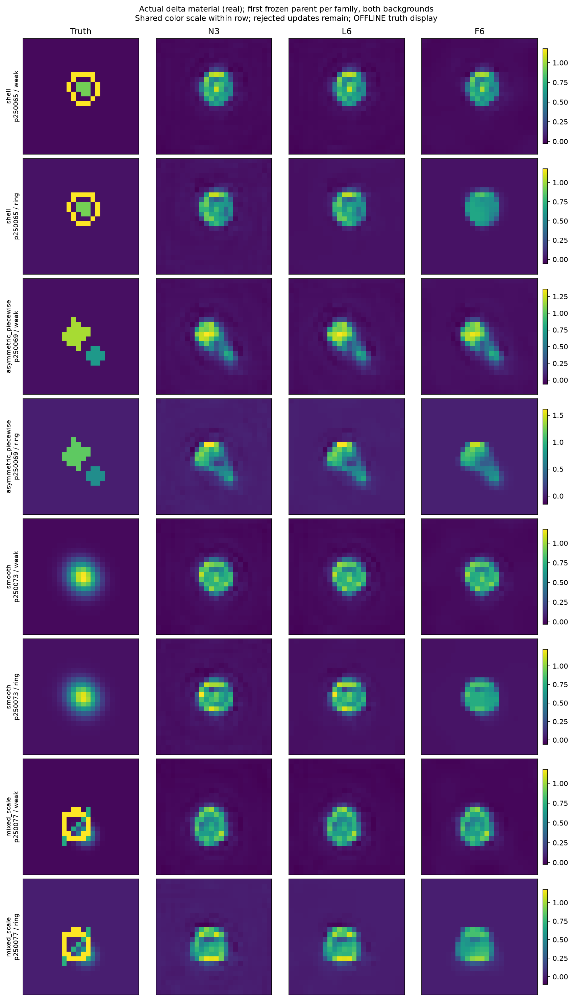

# A28 E1 — Decisive Maxwell Material-Information Experiment

完整中文研究入口：[E1_DECISION.md](E1_DECISION.md)。固定材料对有测量判别信息，当前候选和更新没有把它转化为可靠的复杂结构恢复。

- 复杂三家族中，完整 F 六步相对 N3 材料改善 **1.01%**，95% parent bootstrap 区间 **[−0.76%, 2.57%]**；相对 L 六步 **0.40% [−1.10%, 1.78%]**。
- 同时完整数据残差相对 N3 下降 **27.33%**。数据拟合收益不能代替材料成像收益。
- 指定反事实、有限条件分布和实际 BP 信息审计完成。κ 恒等式成立，但材料有效偏差和非退化门槛失败。**NO_GO E2 / E3 / κ 网络**；没有执行这些扩展。
- **执行合规 FAIL：**主 campaign 762 次，三次继承真实 tiny-backend 测试另有 45 次；全分辨率已知下界 **至少 807 / 768**，超限至少 39 次。独立 dense-reference 审计尚未完全分类，所以 807 不是精确总数。发现后全部物理/GPU实验停止；原配置、结果、receipt 和门槛不改写。

所有证据来自已暴露的 development；不构成全局 identifiability 证明，也没有部署加速结论。科学裁决、预算合规和网页发布状态独立记录。



## 阅读与证据

- [理论与 E1 specification 原件](theory/a28/A28_RESEARCH_REPORT_ZH.md)：理论与反例，不是实验结论。
- [冻结协议](a28_config.json)、[结果前执行约定](research/A28_E1_PRE_RUN_PLAN.md)、[源码与计数缺陷审计](research/delegated/a28_infrastructure/SOURCE_REVIEW.md)。
- [实际后端核对](results/a28/AUDIT.json)、[成本 microbenchmark](results/a28/MICRO.json)、[结构化证据汇总](results/a28/EVIDENCE_SUMMARY.json)、[机器可读裁决](results/a28/E1_GATE_DECISION.json)。
- [结构反事实](results/a28/anatomy/PAIR_METRICS.csv)、[逐更新材料与数据指标](results/a28/headroom/PER_ITERATION.csv)、[parent 配对统计](results/a28/artifacts/HEADROOM_PAIRED_STATISTICS.csv)。
- [有限 conditional moments](results/a28/posterior/PER_DISTRIBUTION.csv)、[材料决策与风险](results/a28/posterior/DECISIONS.csv)、[实际 BP 信息](results/a28/bp/PAIR_INFORMATION.csv)。
- [全部图表与绘图原表](results/a28/artifacts)、[成本](results/a28/COST_LEDGER.jsonl)、[失败](results/a28/FAILURE_LEDGER.jsonl)、[带 cutoff 的成本汇总](results/a28/COST_SUMMARY.json)。

Git 保存源码、配置、标量证据、图表和原作业摘要。大数组及动作账本在 [E1 Release](https://github.com/migodam/a28-maxwell-material-information/releases/tag/a28-e1-v0.1.0)：

| 资产 | 内容与范围 |
|---|---|
| `A28_E1_RAW_EVIDENCE.zip` | 实际材料轨迹、反事实、current/field/κ、谱数组、CSV、图和原 actions/失败/作业记录；排除 runtime exact-state LU。 |
| `A28_E1_EXPOSED_INPUTS.zip` | 原 A25 的 16 个已暴露 validation parents、已知背景，以及冻结 A26 N3 checkpoint、encoder cache 和预测。无 TRAIN/locked payload，无新标签。 |
| 发布核验与成本 sidecar | 完成发布之后的实际 commit、匿名 HTTP 检查、终态账本；cutoff 与预发布数据包不同。 |

[匿名中文报告](https://raw.githubusercontent.com/migodam/a28-maxwell-material-information/main/E1_DECISION.md) 可供网页 GPT 阅读。不可把仓库可访问性视为科学 GO。

## 物理、数据与权限

复用冻结 A27/A26/A25 后端和已训练 N3：24×24 **2D scalar TM**、已知 weak/ring 背景、8 sources / 32 receivers，complex128/float64；CNN 仍为冻结 float32。材料完整网格 576 complex / 1152 real mass coordinates，测量 512 real、逐源 `[Re32, Im32]`。原标签的相对材料相位固定为 `1+0.2i`。

16 parents × 两背景 × 幅度 1.2 × 20dB = 32 条件。复杂主分析含 shell / asymmetric / mixed-scale 的 12 parents；smooth 的 4 parents 是次要证据。先平均 parent 内背景，再做 2,000 次 paired parent bootstrap。更新、候选生成和接受没有真值权限；真值中心反事实、误差方向、谱诊断和事后偏差校准分别标为 OFFLINE。

没有训练网络、生成新训练标签、触碰 locked ID/OOD、增加 rank/degree 或更换 solver；不把 2D 证据推广为 3D Vector-Maxwell。继承的 A24–A27 文档及 gate 文件是历史资产；**A28 裁决在 E1_DECISION.md**。

## 复现保存的证据：不启动物理实验

已执行的环境与命令保存在 `results/a28/jobs/` 的终态 receipt 和原 manifest（后者在 Release）。XINAN 使用 Python 3.10.9、Torch 2.6.0+cu124、NumPy 2.2.6、SciPy 1.15.3、RTX 4060 Laptop 8GB。CPU 单元验证另有本地环境记录。

在当前 Python/Torch 环境安装 [requirements-a26.txt](requirements-a26.txt) 中依赖即可重算小矩阵和绘图；不需要建立新 CUDA 系统。先将 raw evidence 资产解压到仓库根目录，然后：

```bash
python -B tools/a28_check_source.py reproduce-source-check-001
python -B tools/a28_evidence.py reproduce-evidence-summary-001
python -B tools/a28_driver.py --job reproduce-figures-001 --stage report --device cpu
```

第一条固定仅发现 `test_a28*.py`，执行 arithmetic / fake-ledger / 信息隔离 tests；不会运行继承的真实 Physics2D fixtures。后两条只读已保存 CSV/NPZ。新 job ID 必须唯一；终态 receipt 不覆盖。严格预算历史已恢复为 ≥807，中央 guard 拒绝再启动 GPU、科学阶段或物理预约。为了重跑而删掉旧 receipt 不是合法续跑方式。

## 原实验的可复现入口与限制

实现位于 [src/a28](src/a28)，入口 [tools/a28_driver.py](tools/a28_driver.py) 提供 `audit / micro / freeze / anatomy / headroom / posterior / bp / report / tests / theory`。原执行顺序是 audit → micro → freeze → anatomy → headroom → posterior → bp → report；[原作业记录](results/a28/jobs)保留具体命令、预算和失败。`freeze` 使用 TRAIN 校准规则，而公开输入包只提供已暴露 development；直接复用冻结规则不需要 TRAIN 标签。

若未来独立批准完整复现实验，应在新的空输出/账本中保留同一源码、冻结规则、known-background cache 和明确的新预算，并首先把所有分辨率的真实 tests 与 reference audits 纳入统一预约。不得将本仓库的违规记录清零后称为本次执行继续合规。原 768 上限没有扩大，本交付不启动该复现实验。

冻结来源：[A27 `325cc8a`](https://github.com/migodam/a27-feedback-failure-attribution/tree/325cc8a5f99d686ce1b1570296f94b0df1e90141)、[A26 `2603f3b`](https://github.com/migodam/a26-om-feedback-prior-completion/tree/2603f3bd16c48e48587fedc4363975779def17f5)、[A25 `59d8cc5`](https://github.com/migodam/a25-adaptive-om-feedback/tree/59d8cc57c9da99ccb7978febc308193c43d6f3e5)。原来源、负结果与失败均保留；不执行 SHA256 检查。
